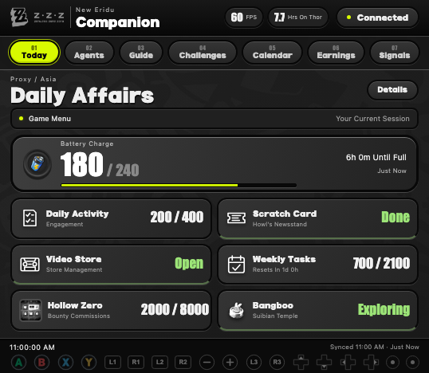
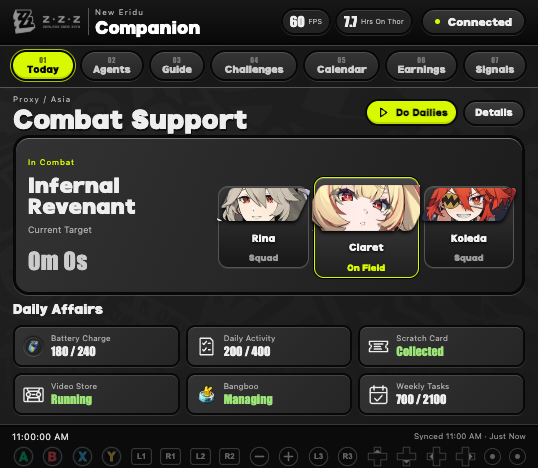
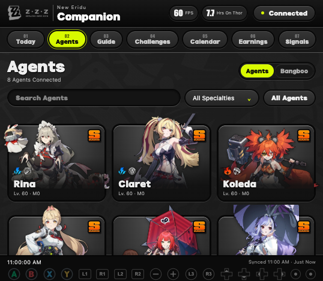
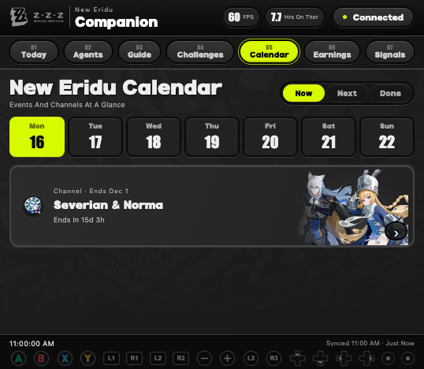
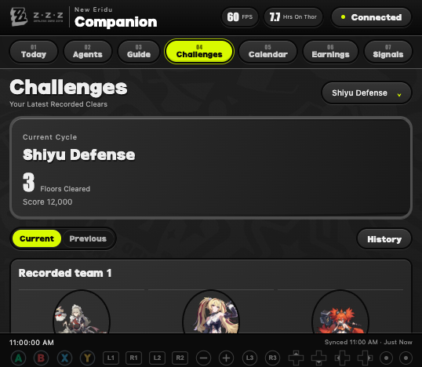
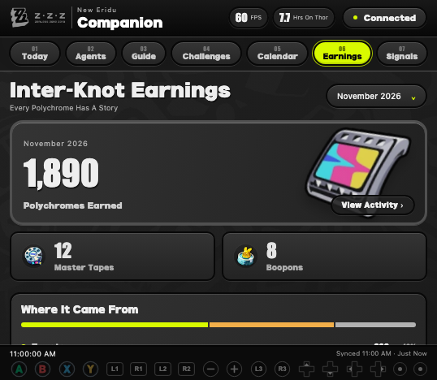
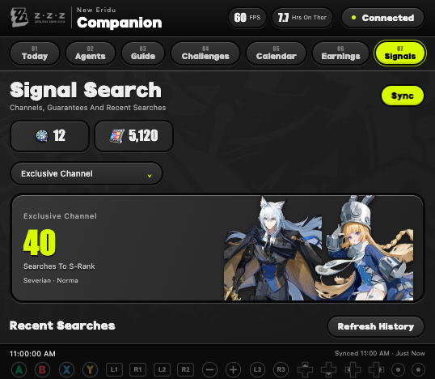
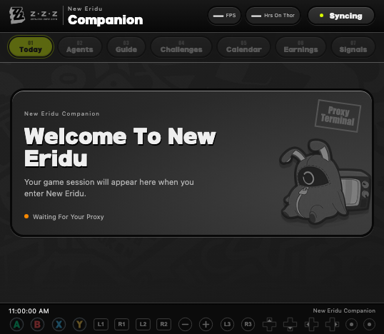
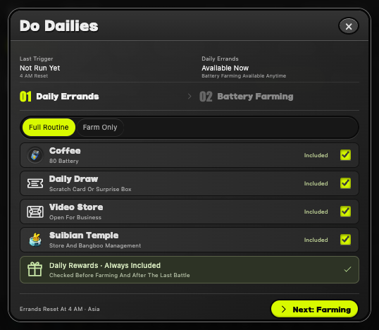
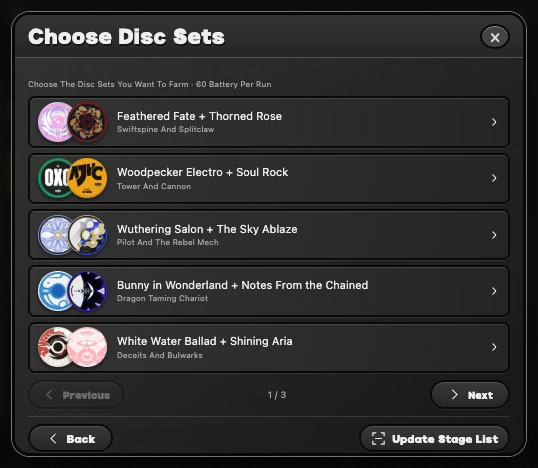

# New Eridu Companion

[](https://github.com/gbppimentel-dev/new-eridu-companion/releases)
[](https://github.com/gbppimentel-dev/new-eridu-companion/actions/workflows/ci.yml)
[](LICENSE)

**a second-screen companion for Zenless Zone Zero on AYN Thor.** keep the game on top and use the lower screen for daily affairs, agents, builds, challenges, events and account records, with ZZZ artwork and controller feedback.

[download the preview](https://github.com/gbppimentel-dev/new-eridu-companion/releases/tag/v2.6.4) · [setup](docs/SETUP.md) · [compatibility](docs/COMPATIBILITY.md) · [report a bug](https://github.com/gbppimentel-dev/new-eridu-companion/issues/new/choose)

**status:** v2.6.4 development preview with Temple navigation, reward-popup and Video Store confirmation fixes. Targeted checks passed; the final controller-chord update still needs device validation. Screen recognition is observational. See [routine validation](docs/DAILY-ROUTINE.md) for the tested scope and remaining work.

## what it does

- **Today:** Battery Charge, activity, scratch card, video store, weekly tasks, Hollow Zero and Bangboo status. incomplete values stay white, completed/okay values turn green, and full Battery Charge turns red.
- **Automation:** opt-in daily errands, mandatory reward checks, material/Disc/Expert farming and one exact final-batch Backup Charge top-up.
- **Agents & Bangboo:** a compact roster, original cutouts, rarity art, equipment and skill details.
- **Guide:** completion progress, automatic next steps and available official build recommendations.
- **Challenges:** recorded clears, teams, scores and cycle summaries when supplied by the service.
- **Calendar:** events, reward progress and featured agent/W-Engine channels.
- **Earnings & Signals:** available income records, balances, channel progress and retained pull history.
- **visible game context:** local HUD classification and portrait comparison, a three-agent encounter layout with the confirmed on-field agent centered, and an encounter clock that survives short interruptions.
- **Thor telemetry:** actual presented-frame FPS when measurable, recorded playtime and passive controller feedback.
- **paired sessions:** Home preserves the companion task. optional [Paired Home](extras/paired-home/README.md) coordinates two-screen Home and repairs incomplete resumes.

**data timing:** HUD/controller observations use a local adaptive loop. account sections have a five-second minimum request interval, additional source-specific intervals, and verification/rate-limit backoff. a fast local observer does not make HoYoLAB records instantaneous.

**connection:** sign in through the official HoYoLAB web flow inside the app. the separate HoYoLAB app does not share its login automatically. account services require internet; bundled art/catalog and saved records have local fallbacks.

## screenshots

These are **synthetic UI previews**, rendered at the Thor lower-screen viewport (538×468). Values and account state are illustrative; they are not live recognition evidence or a real player's account.

<table>
<tr><td width="50%"><a href="docs/images/today.png"></a><br><b>daily affairs</b> · charge, tasks and status</td><td width="50%"><a href="docs/images/combat.png"></a><br><b>combat support</b> · centered on-field agent</td></tr>
<tr><td><a href="docs/images/agents.png"></a><br><b>agents</b> · original character art</td><td><a href="docs/images/calendar.png"></a><br><b>calendar</b> · events and channels</td></tr>
<tr><td><a href="docs/images/challenges.png"></a><br><b>challenges</b> · recorded progress</td><td><a href="docs/images/earnings.png"></a><br><b>earnings</b> · available income records</td></tr>
<tr><td><a href="docs/images/signals.png"></a><br><b>signals</b> · channel progress and history</td><td><a href="docs/images/waiting.png"></a><br><b>before login</b> · empty session state</td></tr>
<tr><td><a href="docs/images/daily-plan.png"></a><br><b>daily routine</b> · select errands and farming</td><td><a href="docs/images/disc-sets.png"></a><br><b>disc farming</b> · paired artwork and set names</td></tr>
</table>

## install

1. **install ZZZ** and use your own HoYoLAB account.
2. **install the signed preview APK** from [releases](https://github.com/gbppimentel-dev/new-eridu-companion/releases/tag/v2.6.4).
3. **connect the account** from the companion's Account screen and select the correct game role/region. enable the needed Battle Records visibility in HoYoLAB.
4. **pair in Cocoon:** open the ZZZ entry's options → companion app → New Eridu Companion → lower display.
5. **launch through Cocoon.** the dashboard waits for a matching visible game UID instead of treating old saved data as a live session.

**optional two-screen Home:** install Paired Home, then assign Wayfinder's Home tap to open it on the lower screen. retain Cocoon as the default launcher. see [paired sessions](docs/SETUP.md#paired-sessions).

## tested scope & limits

| component | development evidence |
| --- | --- |
| **device** | one AYN Thor, primary Android user, Android 13 |
| **displays** | game on logical 0; companion on logical 4; 538×468 lower-screen CSS viewport |
| **firmware access** | existing privileged AYN `PServerBinder` service |
| **launcher** | Cocoon 3.11; optional Wayfinder 1.4.1 Home binding |
| **game context** | captured-HUD checks and limited physical-device observations |
| **public v2.4.2 export** | portable build and synthetic/host checks; fresh-account device validation remains open |

**recognition:** public portrait matching is not guaranteed across every character, costume, animation or HUD arrangement. the bundled bank contains 36 available public portrait identities and can be extended by account roster refreshes; that does not certify every identity in live play. uncertain agents stay unidentified and the on-field tag waits for repeated agreement.

**enemies:** no exact enemy census is available. the old health-bar-derived total was removed. names are shown only when screen text can identify them.

**account records:** availability, history coverage, publishing delays, verification and service changes can affect individual sections. cached data is timestamped. no game-memory access, game-file patches, save editing are used. Daily gameplay automation is opt-in; [validation is still in progress](docs/DAILY-ROUTINE.md).

[compatibility matrix](docs/COMPATIBILITY.md) · [validation record](docs/validation-v2.6.4.json) · [open tasks](TASKS.md)

## docs & development

- **[setup](docs/SETUP.md):** account connection, Cocoon pairing, Home/Resume/Quit and recovery.
- **[architecture](docs/ARCHITECTURE.md):** account requests, local observation and session coordination.
- **[privacy](docs/PRIVACY.md):** credentials, screen processing and local storage.
- **[building](docs/BUILDING.md):** portable builds, signing, checks and release packaging.
- **[release notes](docs/releases/v2.6.4.md)** · **[changelog](CHANGELOG.md)** · **[contributing](CONTRIBUTING.md)**

```sh
node tests/ui-state.cjs
python3 tests/native-checks.py
python3 tests/publication-audit.py
python3 build.py
```

Set `JAVA_HOME` to JDK 21 and `ANDROID_HOME` to an Android SDK with platform 36 and build-tools 36.0.0. builds are unsigned unless an external keystore and signing environment are supplied. CI has no signing key or account credentials.

## credits & license

**made by:** [gbppimentel-dev](https://github.com/gbppimentel-dev).

Original code is [MIT](LICENSE). HoYoverse artwork, fonts, branding and derived catalogs retain their separate rights. [Third-party notices](THIRD_PARTY_NOTICES.md) cover game assets, OCR libraries and adapted Underworld Companion interaction code.

This is an unofficial fan companion, independent of HoYoverse, AYN, Cocoon, Wayfinder and Enka.Network. Their services and products have their own terms and behavior.
